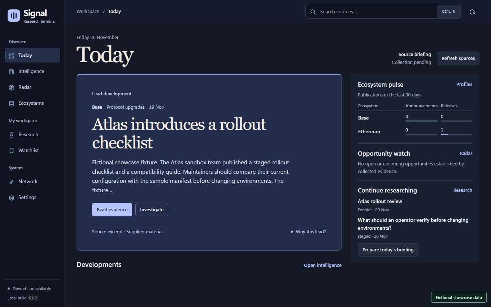

# SIGNAL

**Crypto intelligence, connected.**

SIGNAL is a local-first research workstation for discovering ecosystem developments, examining their sources, monitoring opportunities, and maintaining evidence-backed research dossiers.



## What the showcase covers

- Today and Intelligence for discovering developments and inspecting provenance.
- Radar for reviewing opportunity requirements, deadlines, and lifecycle evidence.
- Ecosystem profiles, research preparation, and persistent dossiers.

The gallery captures the 0.6.3 workstation with fictional examples. This repository contains the standalone website. Live FLOP inference remains disabled pending verified testnet availability and activation. SIGNAL is an independent project designed to integrate with [FLOP infrastructure](https://flop.finance/).

## Preview and deploy

Use Python 3 to assemble the static site and serve it locally.

```sh
python build.py _site
python -m http.server 8000 --bind 127.0.0.1 --directory _site
```

The Pages workflow builds the same allowlisted files, uploads its artifact, and deploys to the `github-pages` environment. Select **GitHub Actions** as the repository’s Pages source. Only the generated static directory is deployed.

## Licensing

Publication permits viewing the showcase. No open-source license is granted for SIGNAL, site code, or branding. The screenshots depict the SIGNAL interface, which uses [Tabler](https://github.com/tabler/tabler) and [Tabler Icons](https://github.com/tabler/tabler-icons). The public repository does not distribute these packages or the local application.
